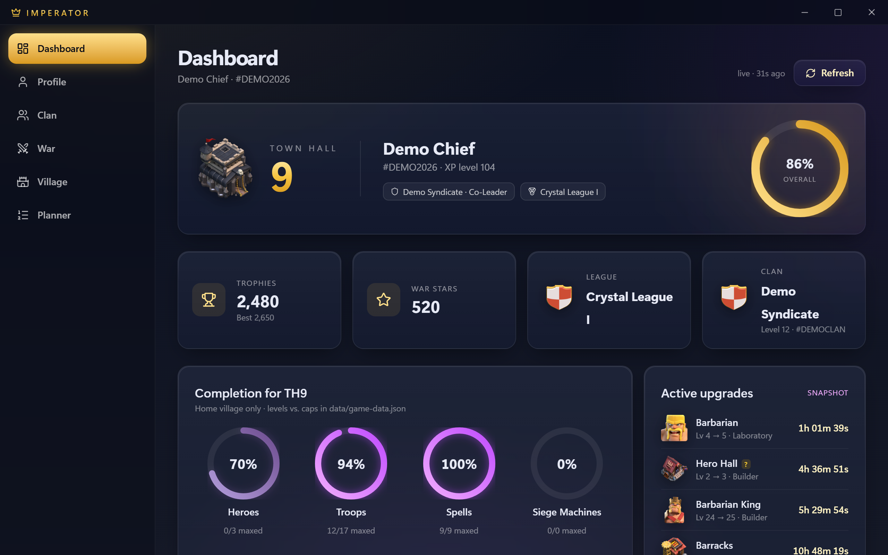
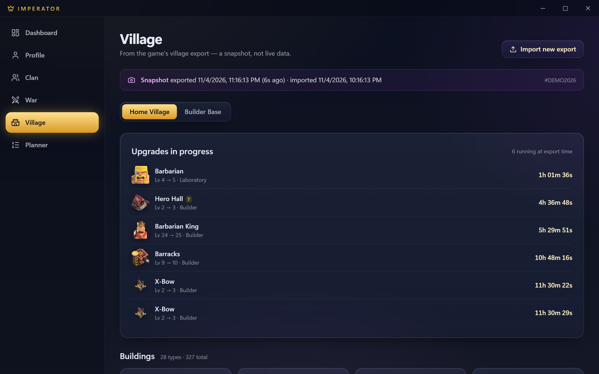
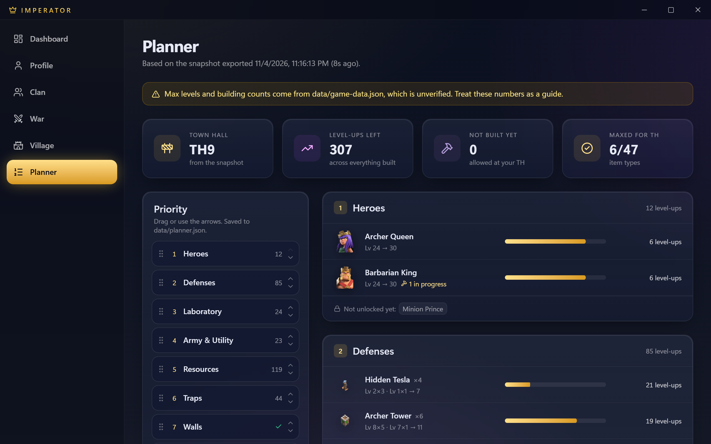
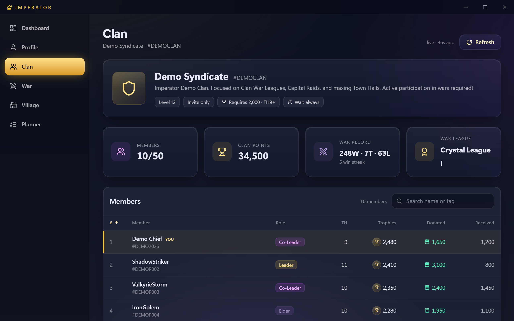
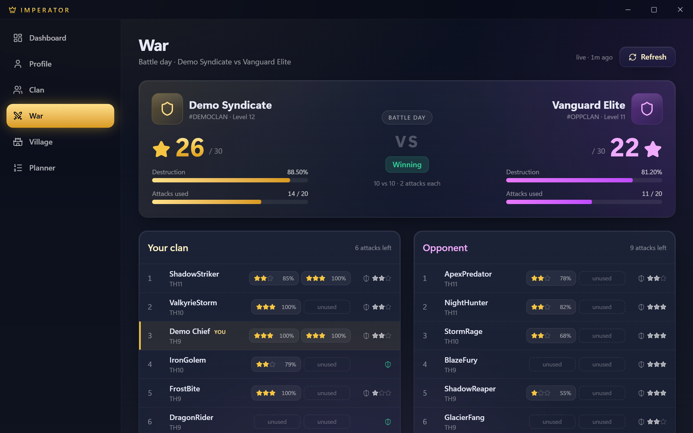
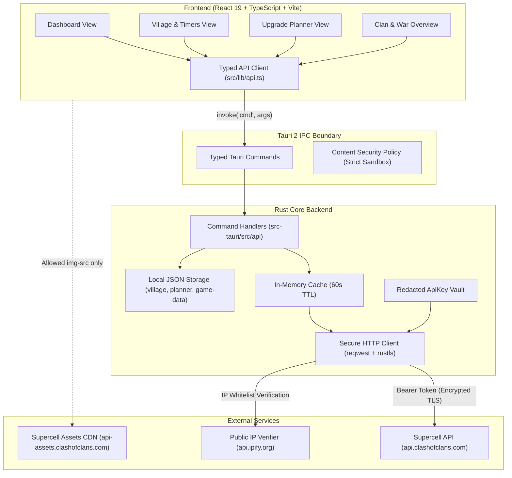

<div align="center">


# Imperator

Personal Clash of Clans companion for Windows, built with Tauri 2 and React.

[](https://github.com/projectGloria/Imperator)
[](https://tauri.app/)
[](https://react.dev/)
[](https://www.typescriptlang.org/)
[](https://www.rust-lang.org/)

[About](#about) · [Features](#features) · [Screenshots](#screenshots) · [Architecture](#architecture) · [Prerequisites](#prerequisites) · [Installation](#installation) · [Development Setup](#development-setup) · [Usage](#usage) · [Building from Source](#building-from-source) · [Configuration & Game Data](#configuration--game-data) · [Security](#security) · [Contributing](#contributing) · [License & Credits](#license--credits)

</div>

<p align="center">
  
</p>

## About

Imperator is a private, local-only desktop companion for Clash of Clans players on Windows. It combines live Supercell API data with exported village snapshots to track upgrade progress, live countdown timers, clan rosters, and clan wars in an interface designed specifically for the desktop.

Unlike cloud trackers and web dashboards, Imperator requires no third-party accounts, runs zero server infrastructure, and collects no telemetry. All API requests are proxied and authenticated directly through the compiled Rust backend—keeping your credentials strictly on your machine and off the webview.

## Features

- **Local-Only Privacy**: Zero telemetry, no third-party servers, and no user accounts. Your API token never enters the webview layer or leaves your device.
- **Village Snapshot Import & Live Timers**: Parses in-game village JSON exports into active builder and laboratory countdowns with real-time level breakdowns.
- **Town Hall Upgrade Planner**: Reorderable upgrade planner calculates remaining laboratory, hero, defense, and building upgrades against Town Hall caps defined in [data/game-data.json](data/game-data.json).
- **Clan & War Tracking**: Browse clan rosters with search and sorting filters, inspect current War lineups, and review destruction percentages, attack logs, and scoreboards.
- **Progress Tracking**: Automatic completion percentages calculate your progress across home-village heroes, troops, spells, and siege machines against per-TH caps.
- **Native Fan Kit Artwork**: Native asset resolution supporting official local Supercell Fan Kit art in `art/`, remote CDN clan badges and league crests, and vector line icon fallbacks.
- **IP Mismatch Detection**: Built-in public IP detector alerts you when your current IP shifts away from your Supercell Developer Portal token whitelist.

## Screenshots

<p align="center">
  
  <br /><em>Dashboard: Town Hall status, overall completion rings, active builder countdowns, and trophy statistics.</em>
</p>

<p align="center">
  
  <br /><em>Village: Parsed snapshot countdowns, builder and laboratory queues, and building level distribution.</em>
</p>

<p align="center">
  
  <br /><em>Planner: Customizable upgrade roadmap prioritized by category, calculating remaining level-ups to TH max.</em>
</p>

<p align="center">
  
  <br /><em>Clan: Membership breakdown, member search and filtering, roles, trophies, and donation tracking.</em>
</p>

<p align="center">
  
  <br /><em>War: Live clan war scoreboard, side-by-side member lineup destruction percentage, and attack logs.</em>
</p>

## Architecture

Imperator enforces an isolated security model where the user interface runs in a sandboxed webview while network operations and credentials remain strictly contained within the native Rust backend. The frontend communicates with Rust over strongly-typed Tauri IPC commands, ensuring your Supercell API key is never exposed to the web runtime.



## Prerequisites

- **Operating System**: Windows 10 (version 1809+) or Windows 11 with WebView2 runtime (pre-installed on Windows 11).
- **For Development & Building**:
  - [Node.js](https://nodejs.org/) 20+ and `npm`
  - [Rust](https://www.rust-lang.org/) stable toolchain with the MSVC target (`x86_64-pc-windows-msvc`), ensuring `cargo` is available in your PATH (`%USERPROFILE%\.cargo\bin`).
- **Clash of Clans API Key**: Obtain a developer API key and your player tag from the [Supercell Developer Portal](https://developer.clashofclans.com). The key must be whitelisted for your current public IP address.

## Installation

### Packaged Installer

1. Download the latest installer (`.exe`) from the repository releases (or compile locally via [Building from Source](#building-from-source)).
2. Run the NSIS installer to install Imperator on Windows.
3. On first launch, enter your Supercell Developer API Key and Player Tag in the setup wizard. Configuration is saved locally to:
   ```
   %APPDATA%\com.imperator.app\.env
   ```

## Development Setup

Clone the repository and install frontend dependencies:

```powershell
git clone https://github.com/projectGloria/Imperator.git
cd Imperator
npm install
```

Copy the example environment file and configure your credentials:

```powershell
copy .env.example .env
```

Edit `.env` in the project root with your credentials:

```env
COC_API_KEY=<your key from developer.clashofclans.com>
COC_PLAYER_TAG="#XXXXXXXX"
```

> [!NOTE]
> Keep quotes around the player tag. In `.env` syntax, an unquoted `#` is treated as a comment delimiter.

Launch the application in development mode:

```powershell
npm run tauri dev
```

### Testing the Setup Screen in Development

In debug mode, Imperator protects the root `.env` from being modified by the UI setup form. To test the setup wizard without modifying your root `.env`, point the configuration directory to a temporary path:

```powershell
$env:IMPERATOR_CONFIG_DIR = "$env:TEMP\imperator-test"; npm run tauri dev
```

*(This environment variable override is compiled out of release builds.)*

## Usage

### 1. Village Snapshot Import
Because the public Supercell API does not provide active builder upgrade timers, countdowns are imported directly from your game export:
1. Open Clash of Clans on your device, export your village data as JSON, and copy the text.
2. Navigate to the **Village** page in Imperator.
3. Paste the snapshot JSON into the import dialog.
4. Imperator validates the data in Rust, stores the snapshot locally at `data/village.json` (or `%APPDATA%\com.imperator.app\data\village.json` in packaged builds), and calculates real-time upgrade countdowns.

### 2. Town Hall Upgrade Planner
1. Open the **Planner** page to see missing upgrades needed to reach the max level for your current Town Hall level.
2. Drag categories or use the arrow buttons to prioritize your upgrade paths (e.g. Defenses, Heroes, Laboratory). Preferences are persisted locally in `data/planner.json`.

### 3. Adding Official Artwork
Imperator can render official high-resolution game assets through Supercell's Fan Kit:
1. Visit [Supercell Fan Kit](https://fankit.supercell.com) and download unit, hero, building, or spell assets.
2. Place PNG assets directly into the `art/` folder (keep Fan Kit filenames such as `Icon_HV_Hog_Rider.png` or `Building_HV_Cannon_level_12.png`).
3. For custom names, refer to the naming conventions in [art/README.md](art/README.md).
4. Reload the dev application or rebuild the binary to bundle the assets.

## Building from Source

To compile the standalone production installer for Windows:

```powershell
npm run tauri build
```

The resulting NSIS installer executable will be placed in:
```
src-tauri/target/release/bundle/nsis/
```

To run TypeScript verification without bundling:

```powershell
npm run typecheck
```

## Configuration & Game Data

Game caps and unit IDs are defined in [data/game-data.json](data/game-data.json):
- Contains sparse step-maps defining the maximum level of each troop, hero, spell, and building per Town Hall level (`"TH": cap`).
- Units or levels marked with `_todo` in the JSON are unverified entries that can be edited by hand.
- In production builds, this file is copied to `%APPDATA%\com.imperator.app\data\game-data.json` on initial execution. Hand modifications take effect upon clicking the app's Refresh button.

## Security

Imperator adheres to strict security and least-privilege principles:

- **Isolated API Communication**: All external calls to `api.clashofclans.com` are performed in Rust via `reqwest` using `rustls`. The webview layer has zero access to the API token.
- **Redacted Secret Handling**: The `ApiKey` struct in Rust intentionally lacks `Display` and implements a redacted `Debug` implementation to prevent tokens from leaking into logs or traces.
- **Tauri Permissions**: Capabilities defined in [src-tauri/capabilities/default.json](src-tauri/capabilities/default.json) grant only window controls and opening `https://developer.clashofclans.com/*`. Filesystem, shell, and generic HTTP plugins are disabled.
- **Content Security Policy (CSP)**: `img-src` is strictly limited to `'self' data: https://api-assets.clashofclans.com` (for official Supercell CDN clan and league badges). All other external network requests from the webview are blocked.
- **In-Memory Caching**: API responses are cached in memory for 60 seconds to respect Supercell rate limits; manual refreshes bypass cache.

## Contributing

1. Fork the repository on GitHub.
2. Create a feature branch (`git checkout -b feature/my-feature`).
3. Verify TypeScript types:
   ```powershell
   npm run typecheck
   ```
4. Commit your changes and push to your branch (`git push origin feature/my-feature`).
5. Open a Pull Request.

## License & Credits

### License
<!-- TODO: Add a LICENSE file (e.g. MIT, Apache-2.0, or proprietary) to the repository root. -->
No license is currently specified in this repository. All rights reserved by the repository author until a formal license is added.

### Supercell Fan Content Policy
This material is unofficial and is not endorsed by Supercell. For more information see [Supercell's Fan Content Policy](https://supercell.com/en/fan-content-policy/).
